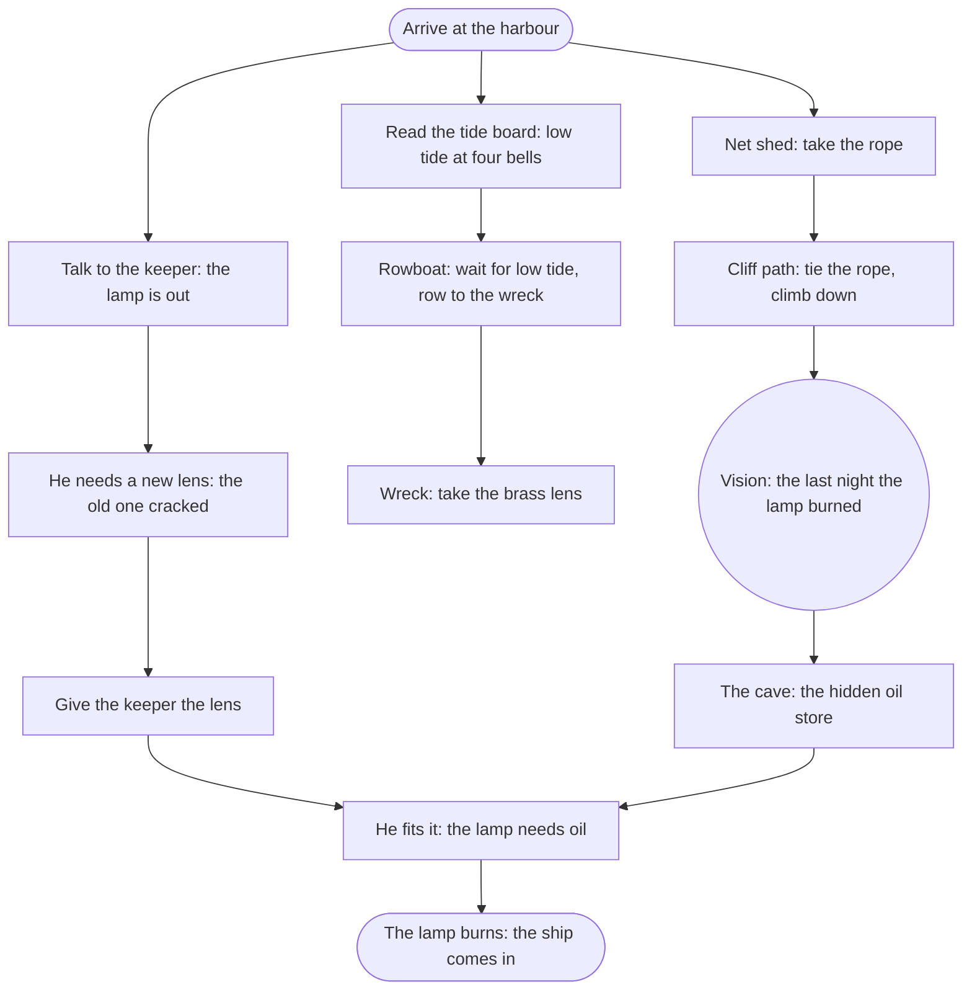

# <Part> — <title>: puzzle chart

Status: <plan> slice <N>, written from the signed bible (`bible.md` §6,
decision #<N>). <N> rooms from `atlas.md`. <How many> threads run side by
side, <names>. They meet at <the gate that needs all of them>.

Drawn before any of the part's art. Every step is something the player does
with the mouse, and every clue it needs is shown somewhere in the game.

## Rooms and exits

| Room | Exits |
|---|---|
| `harbour_square` | right to `harbour_steps`; the shed door to `net_shed` |
| `harbour_steps` | left to `harbour_square`; up to `lighthouse_door`; the rowboat to `wreck` (only at low tide) |

## Items

| Item | From | Used on |
|---|---|---|
| `rope` | the net shed's hook | the cliff post |
| `brass_lens` | the wreck's binnacle | the keeper |
| `oil_can` | the cave, after the vision | the lamp |

## Memories

| Memory | Kind | Where | Whose |
|---|---|---|---|
| `p1_last_night` "The last night" | vision | the cave mouth | the keeper's |

Kinds: **vision** (watched, 30 to 90 s, skippable, rewatchable), **playable
memory** (the past room becomes interactive for a short sequence), **memory
vista** (the area in its good years, with a pull-back).

## The turn

What the player learns in this part that changes the story, where it lands
and which line delivers it. It must be in the bible.

## Flags, in order (the hint goals)

`p1_arrived` → `keeper_met` → `tide_read` → `got_rope` → memory
`p1_last_night` → `got_brass_lens` → `lens_fitted` → `got_oil` → `lamp_lit`.

Each becomes a hint goal in `content/hints/goals.gd` with cues
`<goal>_1`, `<goal>_2`, `<goal>_3` in `content/dialogue/hints.dialogue`.
Optional scenes and memories are listed here too, marked optional.

## Journal

| Entry | Kind | Cue or text |
|---|---|---|
| `p1_last_night` | memory page | `journal.dialogue` cue `p1_last_night` |
| `<fact_id>` | fact the hero learns | <one sentence in the hero's voice> |

## Build notes

- Part entry in `content/chapters.json`: id, title, start room, flags to
  start mid-game, rooms, close-ups, dialogue folders, characters, memories,
  items, cutscenes, `web`.
- Playthrough: `content/story/<part>_playthrough.gd` (`class_name
  <Part>Playthrough`), run by `test/integration/test_<part>.gd` and the
  `<part>` QA scenario.
