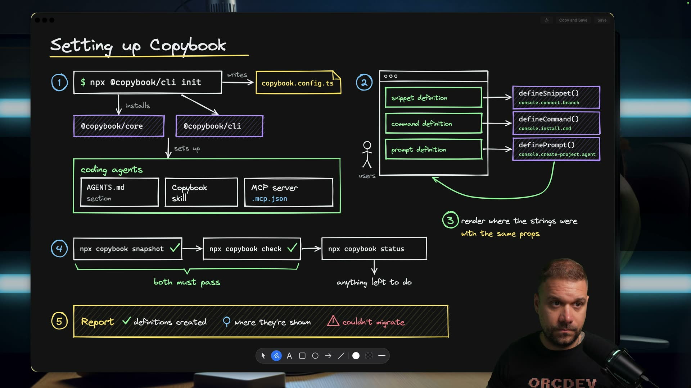

# Video editing skills

Skills for editing recorded OrcDev footage: overlays, drawings and other post-production passes that go on top of a finished take. Each skill is one folder with a `SKILL.md`, plus any templates or scripts it needs beside it. Writing and packaging videos lives in [`videos/`](../videos/README.md).

| Skill | Purpose |
|---|---|
| [excalidraw-drawing](excalidraw-drawing/SKILL.md) | Excalidraw-style diagram drawn onto the on-screen board in sync with the narration, composited over untouched footage |



## Adding a skill

Keep the same shape: `video-editing/<skill-id>/SKILL.md`, an entry in the root `registry.json`, and a row in the table above.

## Installation

Install a skill with the Skills CLI or the shadcn registry. Choose one:

```bash
npx skills add TheOrcDev/skills --full-depth --skill excalidraw-drawing
npx shadcn@latest add TheOrcDev/skills/excalidraw-drawing
```

Use `--full-depth`, because the Skills CLI's default discovery stops at the repository's `skills/` collection.
