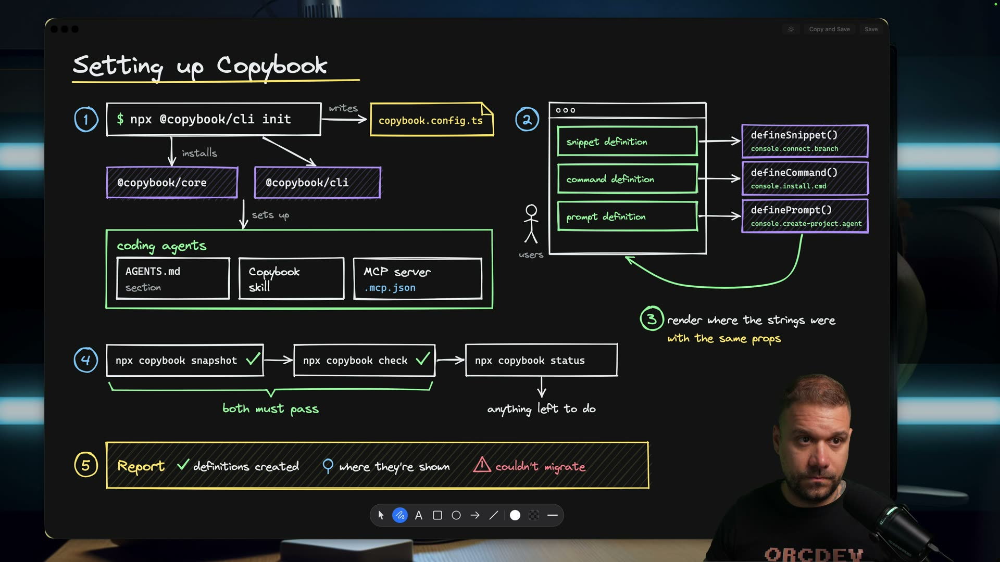

# Excalidraw Drawing

Draw what the speaker explains, on their board, as they say it. One house style for every video.



## Rules

- **Don't change the footage.** No zooms, cuts, crops or grading. Only a transparent layer goes on top. The video gets one high-quality encode and the audio is copied untouched.
- **Same style every time.** Use the tokens and vocabulary in [STYLE.md](STYLE.md). Don't add colors or fonts, and don't swap the sketchy look for crisp vectors.
- **Draw only what is said**, in the order it is said. Each element starts 0.1 to 0.3s before the word that introduces it.
- **Stay on the board.** Keep clear of the webcam, the board toolbar and the window buttons. Everything stays on screen until the board goes away.
- **Flag placeholders.** If the narration names no example (sample strings, IDs), you may invent an illustrative one, but list every invented value in your report.

## Workflow

`<skill>` is this skill's folder. Needs node, ffmpeg and whisper-cli with a ggml model (see the `words.py` header).

Copy this checklist and tick it off:

```
- [ ] 1 Probe the video and find the board window
- [ ] 2 Word timings
- [ ] 3 Scaffold and configure
- [ ] 4 Plan the layout, then write the scene
- [ ] 5 Check stills over the real footage
- [ ] 6 Render the layer, composite, verify
- [ ] 7 Report
```

**1 Probe.** Run `ffprobe` for size, fps and duration. Make a contact sheet (`-vf "fps=1/2,scale=640:-1,tile=6x8"`) to see when the board is up. Then run `python3 <skill>/scripts/find-cut.py VIDEO --from A --to B`: the top jump is the first board frame. If the board also leaves, run it again around the exit. Pull one full-resolution board frame. Measure the board rectangle and the keep-out zones (webcam, toolbar, buttons), and convert them to 1920x1080 units.

**2 Word timings.** `python3 <skill>/scripts/words.py VIDEO out/words.json` prints `12.34:word` for the whole take. It transcribes 14s windows, because word offsets from one long whisper pass drift by up to a second. Read the transcript and split it into the steps the speaker walks through.

**3 Scaffold.** `bash <skill>/scripts/new-board.sh ~/projects/<name>-board` copies [template/](template/), fetches the fonts and installs. Fill in `src/config.ts`: FPS, DURATION_S, BOARD_FRAME, BOARD and KEEP_OUT.

**4 Scene.** Sketch the layout in coordinates first, using the grammar in [STYLE.md](STYLE.md): a title top-left, numbered sections in reading order, one row or block per spoken step. Then write `src/scene.ts` with the vocabulary in `src/dsl.ts`. [examples/copybook-setup.scene.ts](examples/copybook-setup.scene.ts) is a complete 5-step board to copy patterns from.

**5 Check.** From the project, run `bash <skill>/scripts/check.sh VIDEO <last frame>` and open the PNG. It overlays the Guide composition, with red dashed board and keep-out outlines, on the real frame. Look for overflow past the board, text spilling out of its box, overlaps and keep-out hits. Then check 2 or 3 mid-way frames to confirm each step appears with its words. Iterate until it's clean. Never judge layout from a flat background.

**6 Render and composite.**

```bash
npx remotion render src/index.ts Board out/board-layer.mov --frames=<BOARD_FRAME>-<last frame> \
  --scale=2 --codec=prores --prores-profile=4444 --pixel-format=yuva444p10le --image-format=png --concurrency=8
bash <skill>/scripts/composite.sh VIDEO out/board-layer.mov <BOARD_FRAME> <VIDEO dir>/<name>-board.mp4
```

Use `--scale=2` for a 4K source and `--scale=1` for 1080p. A 70s board at 4K takes about 7 minutes, and the composite about 3. `composite.sh` prints both frame counts, which must be equal, and the PSNR of the pre-board footage, which should be above 45 dB. Finally, look at a tiled strip of frames from the output: the frame just before BOARD_FRAME (no drawing), a few mid-draw frames, and the last frame.

**7 Report.** Give the output path, what is drawn for each step, any invented placeholders, and how to re-render (edit `scene.ts`, then render and composite again).

## Gotchas

- **Never create rough.js drawables inside render.** Seeds come from a module-level counter, so build the scene at module level or the strokes jitter every frame.
- **Give the `<svg>` `position: absolute`.** A static svg next to an `AbsoluteFill` paints underneath it, and the frame comes out empty.
- **Measure from the output video, not the probe.** Recording apps (Videorc) can rename a file after recording. If the source disappears, ask for its new path.
- **Check text width in the stills.** Width is estimated per character (Virgil about 0.56em, Cascadia 0.6em) for the writing wipe, so a long label can spill out of its box.
